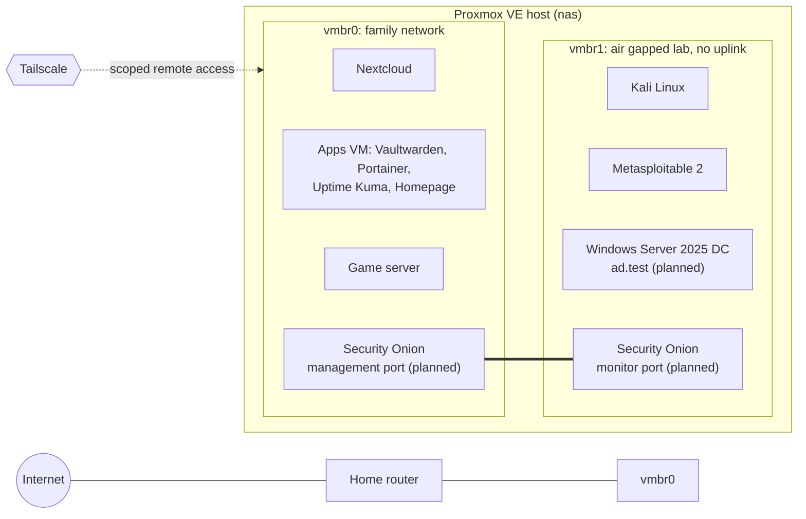

# Proxmox Home Lab

A single Proxmox VE server that does two jobs: it runs a private cloud for my family, and it hosts an isolated cybersecurity lab where I practice blue team work (Active Directory, logging, detection) against attacks I run myself.

I built the hardware, installed and configured everything, and wrote up what broke along the way. This repo is the record of that journey.

## Goals

1. **Family cloud:** replace paid cloud storage with Nextcloud, reachable from anywhere without opening a single port on the home router.
2. **Security lab:** an air gapped network where Kali, deliberately vulnerable targets, a Windows domain and a SIEM can interact without any route to the internet or the family network.
3. **Learn by operating it:** treat the server like production, with least privilege access, monitoring, backups, change records and incident writeups.

## Architecture

vmbr1 has no physical port, no IP on the host and no gateway, so nothing on the lab network can reach the internet or the family network. The only machine with a leg on both sides will be Security Onion, and its lab interface has no IP address. It only listens to mirrored traffic.

## Hardware

| Part | Choice | Why |
| --- | --- | --- |
| CPU | AMD Ryzen 5 9600X | 6 cores is plenty for a handful of VMs at low power |
| Board | MSI PRO X870E P WIFI | AM5, 4 SATA ports, CPU direct M.2 slot |
| RAM | 64GB DDR5 6000 | VMs are memory bound before they are CPU bound |
| Boot | Crucial P310 1TB NVMe | Proxmox OS only |
| VM storage | Samsung 990 PRO 1TB NVMe | LVM Thin pool for every VM disk, in the CPU direct slot |
| Data | 2 x WD Red Plus 8TB | ZFS mirror for family data (CMR drives, which matters for ZFS) |
| Case | Jonsbo N5 | Hot swap bays for future drives |

## What is running

| VM | Role | Network |
| --- | --- | --- |
| 100 | Nextcloud AIO (Docker) with Team Folders per family group | vmbr0 |
| 101 | Kali Linux | vmbr1 |
| 102 | Metasploitable 2 | vmbr1 |
| 103 | Windows Server 2025 domain controller (planned) | vmbr1 |
| 104 | Security Onion SIEM (planned) | vmbr0 management, vmbr1 monitoring |
| 105 | Apps stack: Vaultwarden, Portainer, Uptime Kuma, Homepage, Watchtower | vmbr0 |
| 106 | Modded game server for friends | vmbr0 |

## Security design

* **No port forwarding.** All remote access goes through Tailscale. Public exposure options (Cloudflare Tunnel, Tailscale Funnel) were evaluated and rejected because they would expose the whole Nextcloud instance.
* **Least privilege remote access.** Tailscale grants are additive, so the default allow all rule was removed entirely. My own devices get full access; people I share a device with only reach ports 80 and 443 on Nextcloud, or the game port on the game server.
* **Scoped hypervisor accounts.** A custom Proxmox role with only VM.Audit, VM.Console and VM.PowerMgmt lets a lab user open the lab VMs' consoles and nothing else.
* **Group based access in Nextcloud.** Folders are granted to groups (Family, Extended Family, Business), with a Curators group that can write to otherwise read only folders.
* **Secrets in a self hosted vault.** Vaultwarden serves over HTTPS through Tailscale, and signups were closed after the first account.
* **Update policy.** Watchtower reports on everything but only auto updates the stateless dashboard. Stateful services are updated by hand after a snapshot.

## Roadmap

- [x] Hardware build and Proxmox install
- [x] ZFS mirror and LVM Thin storage pools
- [x] Nextcloud with Tailscale HTTPS and group based Team Folders
- [x] Air gapped lab bridge with Kali and Metasploitable 2, isolation verified with tcpdump
- [x] Apps VM with password manager, monitoring and dashboard
- [x] Static IP and host name hardening (see [incident 001](incidents/001-host-renamed-by-dhcp.md))
- [ ] Scheduled VM backups, plus an off box copy of family data
- [ ] Windows Server 2025 domain controller (ad.test) with advanced audit policy
- [ ] Sysmon on the domain controller
- [ ] Open vSwitch port mirroring on the lab bridge
- [ ] Security Onion 3.0, then attack and detection walkthroughs

## Repo layout

| Folder | Contents |
| --- | --- |
| [docs/](docs/) | [Lessons learned](docs/lessons-learned.md) from what's been built, and [design decisions](docs/design-decisions.md) for what's planned |
| [incidents/](incidents/) | Troubleshooting writeups: symptom, diagnosis, root cause, fix, prevention |
| [detections/](detections/) | Attacks run from Kali and how they showed up in the logs (coming with the SIEM) |
| [configs/](configs/) | Sanitized configs and scripts |

Addresses, account names and anything identifying have been replaced with placeholders. No credentials are stored here.
